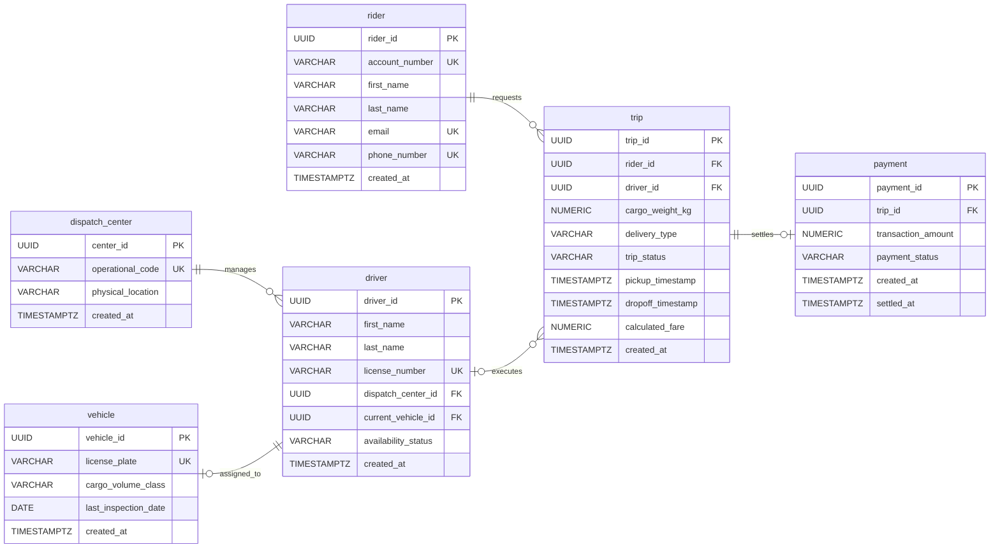

# MIT 8103 Advanced Database Systems: Portfolio Summary

**Case Study:** Ride-Hailing / Logistics System  
**Name:** Yusuf Olalekan  
**Student ID:** 301905721  
**GitHub:** [olasyusuf/Yusuf_Olalekan_301905721](https://github.com/olasyusuf/Yusuf_Olalekan_301905721)  

## Case study
This database is a **ride-hailing and logistics database** for a metropolitan area. It stores information about riders, drivers, vehicles, trips and payments. It enforces strict constraints such as unique entries, valid dates and **one active driver trip**.

## Portfolio 1: Database Design and Modelling
A relational database was designed using normalisation to 3NF to ensure data integrity and eliminate any duplication. The database was named **cargo_ride_portfolio** and was created in PostgreSQL. It contains 6 tables with primary keys set as UUID’s. The database also contains foreign keys, check constraints and a partial unique index to ensure no duplicate active drivers.

After inserting valid test data, 11 constraint violations were tested. This included duplicate emails, negative weights, invalid dates and duplicate drivers. All invalid inserts were rejected as expected. This shows that the constraints in the relational schema will reject any invalid data being inserted. However, procedural transactions are still required to ensure multiple steps are allocated to drivers.

**Figure 1 – 6 tables and relationships**. PK = Primary Key (Unique identifier for a row). FK = Foreign Key (Relationship between tables). UK = Unique Key. Drivers can only be assigned to one dispatch centre and can only be assigned one vehicle. Trips can only be assigned to one rider and one driver. Payments can only be assigned to one trip. Dispatch centres, riders and drivers can have zero or many entries.

## Portfolio 2: Query Processing and Optimisation
5000 completed trips and payments were inserted using a procedural loop called **`profile_data_injection_loop`**. This results in 5003 trips in total. 4 queries were created to determine the number of active **`EN_ROUTE`** trips, available vehicles using **`NOT EXISTS`**, number of trips per customer using **`LEFT JOIN`** and trips with a settled fare greater than average using a scalar subquery. A query was also created to filter trips with a heavy cargo (`cargo_weight_kg > 150.00`). This was tested with and without a partial covering ``B-tree index`` (`idx_active_driver_trip`) being created.

| Performance Metric | Unoptimized Query (Before Indexing) | Optimized Query (After Indexing) |
| :--- | :--- | :--- |
| **Access Strategy** | `Seq Scan on trips` | `Index Only Scan` |
| **Planning Time** | 0.115 ms | 0.085 ms |
| **Execution Time** | 13.110 ms | 0.910 ms |
| **Disk & Memory Buffers** | `shared read=195 hit=32` | `shared hit=42 read=0` |
| **Heap Fetches** | Full table scan | `0` |

Creating the partial index reduced the execution time by 93.05% and there were no more read operations on disk (`read=0`). This means all the data required to answer the query was taken from memory cache (`Heap Fetches = 0`) as it was available in PostgreSQL. These results were recorded on the local PostgreSQL instance where there are 5003 rows. In a live environment, the latency would depend on how much caching there is on the hardware, how much concurrent writes there are and how large the tables are.

## Portfolio 3: Transactions and Concurrency
Transactions were tested using the **`READ COMMITTED`** isolation level. A single transaction was created where a valid update to driver availability was committed. Then a constraint violation was intentionally created to cause a **`ROLLBACK`**. This was tested after the transaction was complete to ensure the valid update was still there and there were 0 rows for the failed trip.
A second transaction was created to test concurrency. This simulates two drivers trying to assign to the same trip. This was done by using **`SELECT ... FOR UPDATE`**. The first session would lock the row and cause the second session to wait until the first session had assigned the trip and committed. When the second session was unlocked it would see the update and rollback. This proves that pessimistic locking can be used to prevent duplicate bookings without locking the whole table.

## Portfolio 4: NoSQL and Advanced Data Models
A local document store was created using **`MongoDB Community Server`** and **`mongosh`**. A collection called delivery_events was created within the **`cargo_ride_portfolio`** database. This was used to store polymorphic logs.
Four (4) event documents were inserted with a fixed date. They all had common top level keys, an embedded actor object and different data. Queries were created to prove there are 4 documents, retrieve the history of trips in order and filter the cargo weight nested data. MongoDB handles dynamic data well but does not support foreign keys. Therefore PostgreSQL will need to be used to ensure data integrity.

## Portfolio 5: Distributed and Cloud Database Exercise
The database is currently running locally with no clustering, replication or sharding. In a live environment a 3-member MongoDB replica set could be used. This would have one primary and 2 voting secondaries.

If the primary goes down, the secondaries will vote for a new primary. This will cause a short delay to write. If 2 nodes go down, the remaining node will go into read only mode (MongoDB, Inc, 2026a). Whilst this will not cause data loss using a majority write concern, the data may not be in sync with the replica set. This means the booking rules should still be kept in **`PostgreSQL`** (MongoDB, Inc, 2026b). As the data is small, sharding is not required (MongoDB, Inc, 2026c). **`MongoDB Atlas`** requires TLS, security and backups. There will also be costs involved with the subscription. As **`MongoDB`** does not replicate the PostgreSQL tables, this is not required (MongoDB, Inc, 2026d)

## Evidence
All SQL schemas, test data, constraint violations, query benchmarks, transaction scripts, MongoDB scripts and screenshots can be found in the project repository at [olasyusuf/Yusuf_Olalekan_301905721](https://github.com/olasyusuf/Yusuf_Olalekan_301905721):
* **Portfolio 1:** Schema, test data, constraint violations and terminal outputs can be found in (`portfolio-1-database-design/`).
* **Portfolio 2:** Data injection, analytical queries, index scripts and `EXPLAIN (ANALYZE, BUFFERS)` outputs can be found in (`portfolio-2-query-optimisation/`).
* **Portfolio 3:** Single-session `COMMIT`/`ROLLBACK` scripts and two-session `FOR UPDATE` locking scripts (`portfolio-3-transactions-concurrency/`).
* **Portfolio 4:** MongoDB batch insertion script (`Yusuf_Olalekan_301905721_P4_MongoDB.js`), README, and terminal screenshot (`screenshots/p4_mongodb_queries.png`).
* **Portfolio 5:** Distributed & Cloud Analysis (`Yusuf_Olalekan_301905721_P5_README.md`).

## Reflection
* **Design:** `Trips` and `payments` were split into a one to one relationship. This ensured the delivery status (`REQUESTED`, `EN_ROUTE`) would change and the payments would not be generated until the trip was complete. There is also a `partial unique index` (`uq_idx_active_driver_trip`) to ensure no more than one active trip can be assigned to a driver.
* **Difficulties:** When benchmarking my query in portfolio 2, I could not get the query to run quicker with standard indexes. This was because PostgreSQL was ignoring them. There were issues with implicit type mismatches and a variable scope error in my data generation loop.
* **Solutions:** I debugged my loop to put the `trip_id` generated into a separate variable. I updated my query to explicitly cast the data types (`::varchar` and `::numeric`) and used `INCLUDE` indexes so the planner could read the data from memory.
* **Learning:** I have learnt that care must be taken when creating constraints and indexes. Just having fixed schemas will not prevent race conditions or duplicate bookings when there are high volumes of dispatches. This means rules should be applied in the database, explicit locks (`FOR UPDATE`) and selecting the correct database engine.

## References
* MongoDB, Inc. (2026a). *Replication*. Available at: https://mongodb.com
* MongoDB, Inc. (2026b). *Replica Set Elections*. Available at: https://mongodb.com
* MongoDB, Inc. (2026c). *Write Concern*. Available at: https://mongodb.com
* MongoDB, Inc. (2026d). *Sharding*. Available at: https://mongodb.com
* MongoDB, Inc. (2026e). *Back Up, Restore, and Archive Clusters*. Available at: https://mongodb.com
* MongoDB, Inc. (2026f). *MongoDB Shell (`mongosh`) Documentation*. Available at: https://mongodb.com
* PostgreSQL Global Development Group. (2026). *PostgreSQL 16 Documentation: Constraints and Concurrency Control*. Available at: https://postgresql.org

## AI-use declaration
* **Tools:** Google Gemini
* **Support Received:** Helped to create documentation in markdown format, Mermaid ER diagram and initial scripts for SQL and MongoDB.
* **Validation:** I have created the case study, rules and database design. I have run all scripts in SQL and `mongosh` locally. I have validated all terminal outputs to ensure they are as expected. I have resolved any errors in the schemas and queries.
