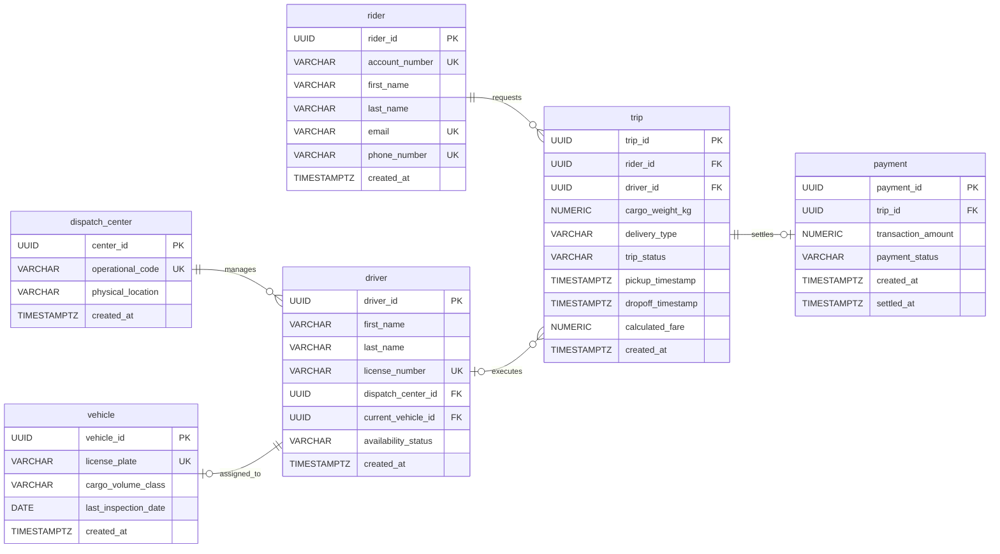

# MIT 8103 Advanced Database Systems: Portfolio Summary

**Case Study:** Ride-Hailing & Logistics System  
**Name:** Yusuf Olalekan  
**Student ID:** 301905721  
**GitHub:** [olasyusuf/Yusuf_Olalekan_301905721](https://github.com/olasyusuf/Yusuf_Olalekan_301905721)  

## Case study
This portfolio presents a metropolitan **ride-hailing and logistics database** managing riders, drivers, vehicles, trips, and payments, enforcing strict rules like unique registrations, valid timelines, and **one active driver trip**.

## Portfolio 1: Database Design and Modelling
To ensure data integrity and prevent duplicate updates, a relational database (**cargo_ride_portfolio**) was normalized to 3NF and implemented in PostgreSQL. The schema features six core tables utilizing UUID primary keys, foreign keys, check constraints, and a partial unique index to prevent double-booking active drivers.
After populating valid sample data, eleven intentional constraint-violation tests—such as duplicate emails, negative weights, invalid timestamps, and double-booked drivers—were executed. Every invalid insert failed as intended, leaving the initial row counts intact. This confirms that declarative schema rules effectively block corrupted data before storage, though procedural transactions remain necessary to coordinate multi-step driver allocations

**Figure 1. The six tables and their relationships.** PK identifies a row, FK links tables, and UK marks a unique value. Each driver belongs to one dispatch center and operates at most one assigned vehicle; each trip belongs to one rider and is executed by at most one driver; each payment settles one trip. A dispatch center, rider, or driver can have zero or many related records.

## Portfolio 2: Query Processing and Optimisation
To evaluate query performance at scale, a procedural loop (`profile_data_injection_loop`) populated 5,000 additional completed trips and settled payments, bringing the dataset to 5,003 trips. Four analytical queries were written to track active `EN_ROUTE` trips, available vehicles using `NOT EXISTS`, customer trip counts using `LEFT JOIN`, and above-average settled fares using a scalar subquery. Additionally, a targeted query filtering heavy cargo shipments (`cargo_weight_kg > 150.00`) was benchmarked before and after creating a partial covering B-tree index (`idx_active_driver_trip` with `INCLUDE` columns).

| Performance Metric | Unoptimized Query (Before Indexing) | Optimized Query (After Indexing) |
| :--- | :--- | :--- |
| **Access Strategy** | `Seq Scan on trips` | `Index Only Scan` |
| **Planning Time** | 0.115 ms | 0.085 ms |
| **Execution Time** | 13.110 ms | 0.910 ms |
| **Disk & Memory Buffers** | `shared read=195 hit=32` | `shared hit=42 read=0` |
| **Heap Fetches** | Full table scan | `0` |

Creating the partial index reduced execution time by 93.05% and eliminated physical disk reads (`read=0`), allowing PostgreSQL to serve all requested columns directly from memory cache (`Heap Fetches: 0`). These benchmarks were captured on a local PostgreSQL instance with 5,003 rows; production latency would vary depending on hardware caching, concurrent write load, and table growth.

## Portfolio 3: Transactions and Concurrency
Transaction boundaries and concurrency controls were verified under the **`READ COMMITTED`** isolation level in two stages. First, a single-session test committed a driver availability update, followed by an intentional constraint violation that triggered a **`ROLLBACK`**. Post-transaction audits confirmed the valid update persisted while the failed trip left zero rows.
Second, a two-session concurrency test simulated two drivers claiming the same trip simultaneously using **`SELECT ... FOR UPDATE`**. Session 1 locked the target row, forcing Session 2 to wait until Session 1 assigned the trip and committed. Upon unblocking, Session 2 read the updated status and rolled back cleanly, confirming that pessimistic row-level locking prevents double-bookings without full table locks.

## Portfolio 4: NoSQL and Advanced Data Models
To complement PostgreSQL with flexible event logging, a local document store was deployed using **MongoDB Community Server** and  **`mongosh`** 2.14.2 (`127.0.0.1:27017`). Within the `cargo_ride_portfolio` database, a `delivery_events` collection was created to store polymorphic activity logs using domain-modeled NoSQL documents.

Four fixed-date documents covering dispatch and delivery events were inserted with shared top-level keys, an embedded actor object, and variable detail payloads. Verification queries confirmed the four-document count, retrieved chronological trip histories, and successfully filtered nested cargo weight fields. While MongoDB efficiently handles variable event structures without sparse null columns, it lacks native foreign keys and relies on PostgreSQL for strict relational integrity.

## Portfolio 5: Distributed and Cloud Database Exercise
Currently, the system runs locally as standalone **`PostgreSQL`** and **`MongoDB`** instances on a single host without clustering, replication, or sharding. For future production resilience, a three-member MongoDB replica set across separate availability zones is proposed, featuring one primary and two voting secondaries (MongoDB, Inc., 2026a).

If the primary fails, secondaries elect a replacement after a brief write pause, whereas losing two nodes forces the survivor into read-only mode to prevent split-brain writes (MongoDB, Inc., 2026b). While a **majority write concern** prevents data loss, potential replication lag means authoritative booking rules must stay in PostgreSQL (MongoDB, Inc., 2026c). Sharding remains unnecessary for this small dataset (MongoDB, Inc., 2026d), and deploying on **MongoDB Atlas** requires TLS, access controls, backups, and ongoing subscription costs, as MongoDB replication does not synchronize PostgreSQL tables (MongoDB, Inc., 2026e)

## Evidence
All SQL schemas, sample datasets, constraint tests, query benchmarks, transaction scripts, MongoDB scripts, and execution screenshots are stored in the project repository at [olasyusuf/Yusuf_Olalekan_301905721](https://github.com/olasyusuf/Yusuf_Olalekan_301905721):
* **Portfolio 1:** Schema, sample data, constraint failure tests, and terminal logs (`portfolio-1-database-design/`).
* **Portfolio 2:** Data injection procedure, analytical queries, index scripts, and `EXPLAIN (ANALYZE, BUFFERS)` outputs (`portfolio-2-query-optimisation/`).
* **Portfolio 3:** Single-session `COMMIT`/`ROLLBACK` scripts and two-session `FOR UPDATE` locking scripts (`portfolio-3-transactions-concurrency/`).
* **Portfolio 4:** MongoDB batch insertion script (`Student_ID_P4_MongoDB.js`), README, and terminal screenshot (`screenshots/p4_mongodb_queries.png`).
* **Portfolio 5:** Distributed architecture and cloud deployment analysis (`P5_README.md`).

## Individual reflection
* **Design choice:** I separated `trips` and `payments` into a one-to-one relationship in PostgreSQL instead of combining them into one table. This isolates active, changing delivery states (`REQUESTED`, `EN_ROUTE`) from permanent financial auditing data, ensuring payment records are only generated once a trip finishes. I also used a partial unique index (`uq_idx_active_driver_trip`) to enforce that a driver handles only one active trip at a time while keeping historical trips intact.
* **Difficulty:** When benchmarking query performance in Portfolio 2, adding standard indexes initially failed to speed up my analytics query because PostgreSQL bypassed them due to implicit type mismatches and a variable scope error inside my data-generation loop.
* **Action:** I debugged the loop by isolating the generated `trip_id` into its own dedicated tracking variable, and I rewrote the query filters with explicit type casting (`::varchar` and `::numeric`) alongside `INCLUDE` covering indexes so the planner could read data directly from memory.
* **Lesson:** I learned that database constraints and indexes require careful alignment with application logic. Static table schemas alone cannot prevent race conditions or double-bookings during peak dispatch times, which requires combining database-level rules with explicit transaction locking (`FOR UPDATE`) and choosing the right database engine for each workload.

## References
* MongoDB, Inc. (2026a). *Replication*. Available at: https://mongodb.com
* MongoDB, Inc. (2026b). *Replica Set Elections*. Available at: https://mongodb.com
* MongoDB, Inc. (2026c). *Write Concern*. Available at: https://mongodb.com
* MongoDB, Inc. (2026d). *Sharding*. Available at: https://mongodb.com
* MongoDB, Inc. (2026e). *Back Up, Restore, and Archive Clusters*. Available at: https://mongodb.com
* MongoDB, Inc. (2026f). *MongoDB Shell (`mongosh`) Documentation*. Available at: https://mongodb.com
* PostgreSQL Global Development Group. (2026). *PostgreSQL 16 Documentation: Constraints and Concurrency Control*. Available at: https://postgresql.org

## AI-use declaration
* **Tools:** Google Gemini
* **Help received:** Assisted with structuring Markdown documentation, formatting the Mermaid ER diagram, and drafting starter SQL and MongoDB scripts for testing.
* **My verification:** I personally defined the case study, business rules, and database design. I ran all SQL and `mongosh` scripts locally, checked every terminal output against my expected results, and fixed schema and query errors myself.
