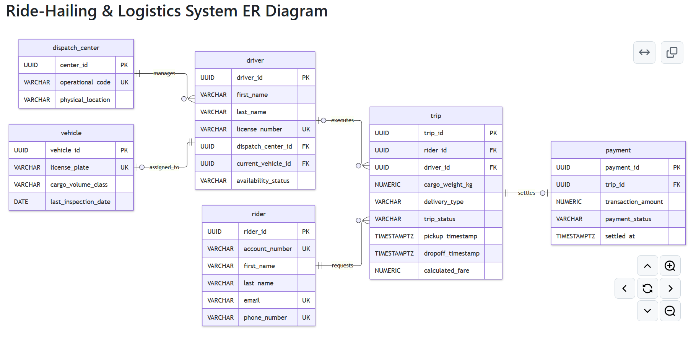
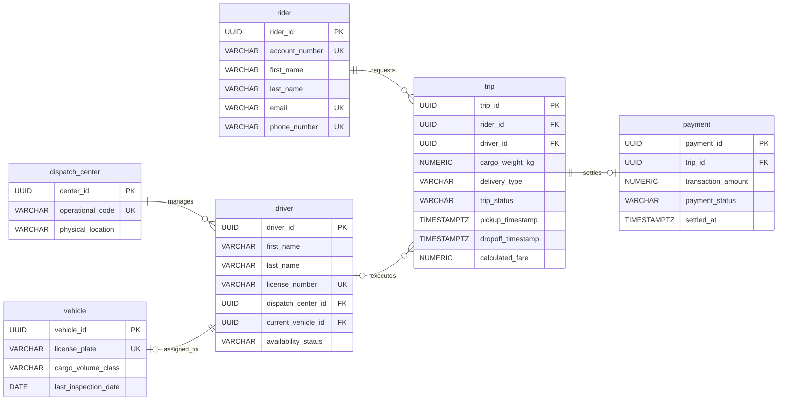

  

   [Home](../Yusuf_Olalekan_301905721_README.md)
 

   

  [ Back ](./Yusuf_Olalekan_301905721_P1_README.md) 
   

  

   
  <h1>Ride-Hailing & Logistics Database Design</h1>

 

## Table of Contents

- [Table of Contents](#table-of-contents)
- [Ride-Hailing & Logistics System ER Diagram](#ride-hailing--logistics-system-er-diagram)
- [Key and Symbol Explanations](#key-and-symbol-explanations)
- [Optional Fields](#optional-fields)

 

  [ [↑ to top ↑](#table-of-contents) ]

## Ride-Hailing & Logistics System ER Diagram

<!--  -->

---

 

  [ [↑ to top ↑](#table-of-contents) ]

## Key and Symbol Explanations

- PK (Primary Key): A field that Uniquely identifies a single record within a table. For example, center_id uniquely identifies a specific corporate dispatch center.

- FK (Foreign Key): A field that establishes a link between tables by referencing the primary key of another table. For example, the rider_id in the trip table connects each trip to the specific customer record who requested it.

- UK (Unique Key): A constraint that ensures values in a field are distinct across the table. For example, license_plate prevents multiple vehicles from sharing the same registration string.

- Relationship Symbols: The diagram uses line ends to show cardinality constraints. The line || represents exactly one, |o represents zero or one, and o{ represents zero or many records. For instance, the notation between rider and trip indicates that exactly one rider (||) can request zero or more historical trips (o{).

---

 

  [ [↑ to top ↑](#table-of-contents) ]

## Optional Fields

- driver.current_vehicle_id: This field is optional because a driver can be off-duty or unassigned to a fleet asset.

- trip.driver_id: This remains empty when a request is initialized and is only filled once a courier accepts the dispatch.

- trip.dropoff_timestamp: This field is optional and remains null until the driver successfully completes the delivery.
- payment.settled_at: This remains empty while the transaction status is pending or failed.

---

 

  [ [↑ to top ↑](#table-of-contents) ]

