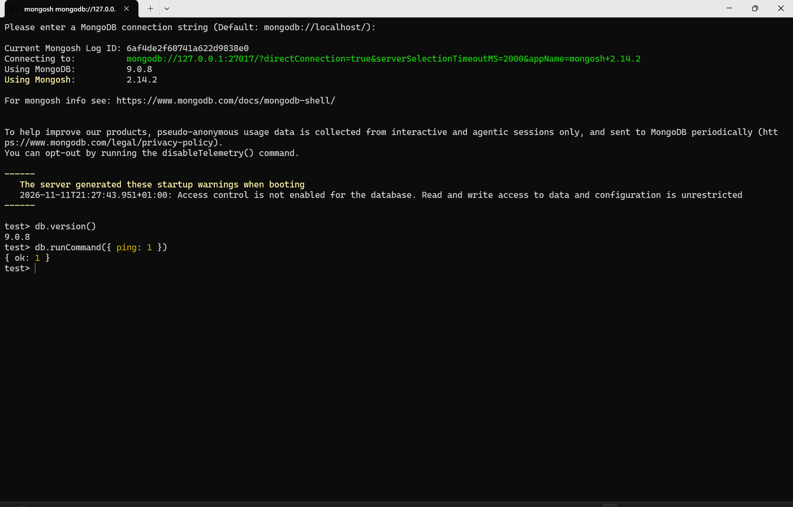

<div style="display: flex; gap: 1rem;">
  <div  style="flex: 1;">

   [Home](../Yusuf_Olalekan_301905721_README.md)
 </div>
<div style="flex: 1;">

   <div align="right">

  [ Back ](./Yusuf_Olalekan_301905721_P4_README.md) 
   </div>
  </div>
</div>

<div align="center">
  <br>
  <h1>MongoDB Local Windows Setup</h1>
</div>

MongoDB runs on the local Windows machine alongside PostgreSQL. The server version is 9.0.8, and the MongoDB Shell (`mongosh`) version is 2.14.2. Its data folder is located in the default Windows service data directory (`C:\Program Files\MongoDB\Server\9.0\data`), outside the repository. Connections use `127.0.0.1` (`27017`), keeping database access strictly local without public port exposure.

<br />

## Table of Contents

- [Table of Contents](#table-of-contents)
- [MongoDB setup (Local Windows)](#mongodb-setup-local-windows)
- [Connect](#connect)
- [Verify Connection](#verify-connection)
- [Switch to Portfolio Database](#switch-to-portfolio-database)

<br />

<div align="right">

  [ [↑ to top ↑](#table-of-contents) ]
</div>

##  MongoDB setup (Local Windows)

*   **Download Official Installers:** Download the official `.msi` package for MongoDB Community Server and the `.msi` or `.zip` package for `mongosh` from the MongoDB Download Center.
*   **Install MongoDB Server:** Run the server installer using the **Complete** setup option and keep **Install MongoDB as a Service** enabled so it runs automatically in the background on `127.0.0.1:27017`.
*   **Install MongoDB Shell:** Run the `mongosh` installer so the `mongosh` command is added to your Windows system PATH.

---

<br />

<div align="right">

  [ [↑ to top ↑](#table-of-contents) ]
</div>

## Connect

```bash
mongosh "mongodb://127.0.0.1:27017"
```

---

<br />

<div align="right">

  [ [↑ to top ↑](#table-of-contents) ]
</div>

## Verify Connection
`db.version()` returns `9.0.8` and `db.runCommand({ ping: 1 })` returns `{ ok: 1 }`.



---

<br />

<div align="right">

  [ [↑ to top ↑](#table-of-contents) ]
</div>

## Switch to Portfolio Database

Run this single command inside your active `test>` prompt to create and switch into your isolated Portfolio 4 database:

```javascript
use cargo_ride_portfolio
```

**Explanation:** MongoDB automatically creates a database when you switch to it and insert your first document, keeping your Portfolio 4 work separate from the default `test` database.

---

<br />

<div align="right">

  [ [↑ to top ↑](#table-of-contents) ]
</div>


## Reference

[MongoDB Local Windows installation guide](https://www.mongodb.com/docs/manual/administration/install-community-windows/?win-method=wizard)
[mongosh Windows installation guide (optional)](https://www.mongodb.com/docs/mongodb-shell/install/?operating-system=windows&windows-installation-method=msiexec)